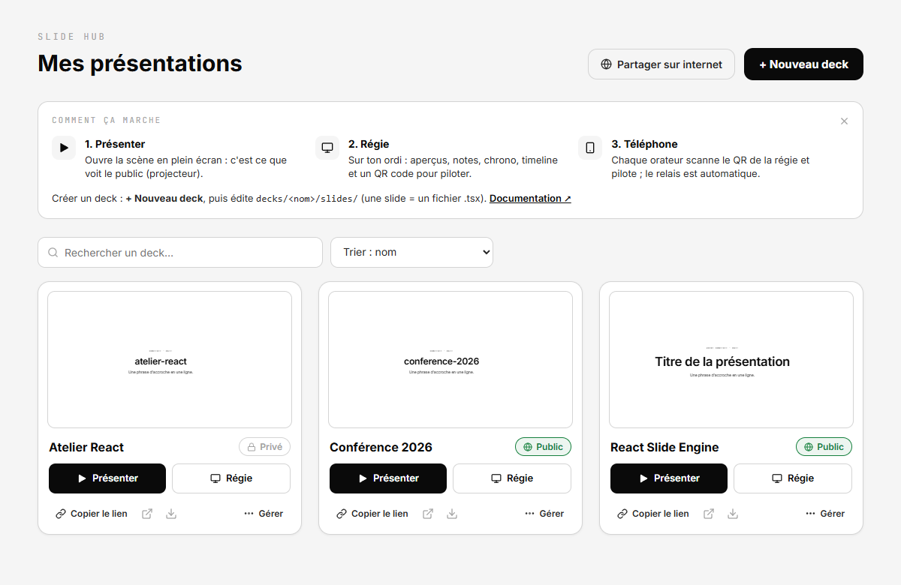
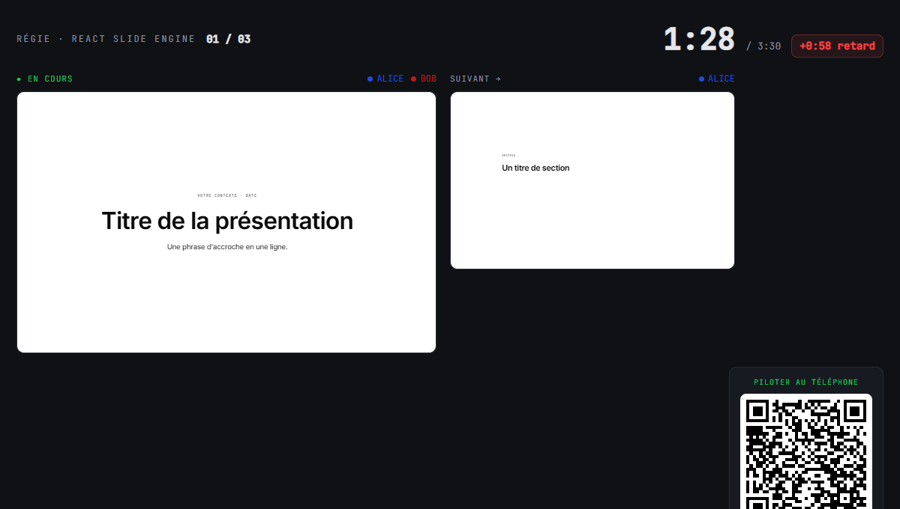

# Slide Hub

Un moteur de présentation React **partagé**, qui sert **plusieurs decks** depuis un seul projet. Slides en vrai TSX (animations, composants custom), pilotage temps réel (scène + console + téléphones), visibilité publique/privée par deck. Un deck = un dossier.



## Démarrer (une commande)

Prérequis : **Node 20.19+** (ou 22.12+). Docker est facultatif (partage internet, déploiement).

```bash
git clone https://github.com/DrEggdwarf/slide-hub.git && cd slide-hub && npm install && npm run dev
```

- `http://localhost:5173/` → index du hub (liste des decks)
- `http://localhost:5173/<deck>` → la prez (en local, `localhost` est admin automatiquement)



Autres commandes : `npm run build` · `npm start` (serveur de prod, exige un mot de passe : `npm run password -- "monsecret"` d'abord) · `npm run password -- "monsecret"` · `npm run typecheck`.

## Créer un deck

Un dossier sous `decks/` :

```
decks/mon-talk/
├── deck.config.ts        # marque, orateurs (nom→couleur), visibilité, ordre
└── slides/
    ├── 01-intro.tsx      # 1 slide = 1 fichier (exporte `meta` + `Component`)
    └── 02-suite.tsx
```

`deck.config.ts` :

```ts
import type { DeckConfig } from '@engine/decks'
const config: DeckConfig = {
  brand: 'Mon talk',
  visibility: 'private',                 // 'public' = visible par tous · défaut : privé
  speakers: { alice: '#1d4ed8', bob: '#b91c1c' },
  order: ['01-intro', '02-suite'],       // optionnel (sinon ordre alphabétique)
}
export default config
```

Une slide importe le moteur via les alias `@engine` / `@ui` / `@design`. **Rien à enregistrer** : le deck est auto-découvert (`import.meta.glob`) et chaque slide est code-splittée (charger `/mon-talk` ne tire que ses slides).

## Gérer les decks (dashboard)

L'index `/` est un **tableau de bord** (en mode admin/local) : cartes avec miniatures live, et pour chaque deck — **Présenter / Régie**, copier le **lien** ou le **chemin du dossier**, **Réglages** (orateurs + couleurs, durée et orateur par slide), **Renommer / Dupliquer / Supprimer**, bascule **public / privé**, et **+ Nouveau deck**. Ces actions écrivent dans `decks/` (mode authoring **local** ; le hub déployé reste en lecture seule). Slides toujours éditées en TSX dans ton éditeur.

Le tableau de bord propose aussi :
- **Recherche et tri** (nom, ou « modifié récemment ») dès 4 decks.
- **Modèles** à la création : « Présentation type » (titre, plan, 3 sections, conclusion) ou « Vide ».
- **Corbeille** : un deck supprimé va dans `decks/.trash` et se restaure depuis le bouton « Corbeille ».
- **Export PDF** (icône ↓ de chaque carte, ou `/<deck>/print`) : toutes les slides, dans leur état final → « Imprimer / Enregistrer en PDF » (marges « Aucune », graphiques d'arrière-plan cochés).
- **« Partager sur internet »** : tunnel Cloudflare (≠ visibilité public/privé d'un deck) → liens et QR basculent sur l'URL publique. Une confirmation liste ce qui devient accessible ; le lien se **coupe automatiquement** après 4 h (`TUNNEL_TTL_HOURS`) ou à l'arrêt du serveur ; il est **refusé tant que le mot de passe est celui par défaut** (`npm run password -- "monsecret"`).

## Routes & pilotage

| Route | Rôle |
|-------|------|
| `/` | index du hub |
| `/<deck>` | scène (projection) |
| `/<deck>/console` | régie présentateur (aperçus, notes, chrono, timeline, QR de pilotage) |
| `/<deck>/print` | export PDF (toutes les slides) |
| `/<deck>/pilote?t=<token>` | régie mobile (téléphone) |

Pilotage : la scène se déverrouille avec le **mot de passe** (panneau `h`) → un **QR** apparaît → les orateurs le scannent et pilotent (relais auto). L'état vit côté serveur, synchro WebSocket, **séparé par deck**.

## Visibilité

- **public** : tout le monde peut regarder le deck.
- **privé** (défaut) : `/<deck>` et `/<deck>/console` exigent le mot de passe avant d'afficher quoi que ce soit (les slides ne sont même pas téléchargées). `/<deck>/pilote` reste accessible via le token du QR.

> Note honnête : les chunks JS d'un deck privé restent techniquement accessibles par URL (déploiement statique). Adéquat pour « garder les curieux dehors », pas pour du vrai confidentiel.

## Déploiement / partage

**Local ou VPS, au choix.** Un seul secret : `PRESENTER_PASSWORD`.

```bash
echo "PRESENTER_PASSWORD=monsecret" > .env

# Local (et réseau de la salle) :
docker compose up -d                  # http://localhost:3000

# Rendre public sans VPS ni compte (tunnel Cloudflare éphémère) :
docker compose --profile share up -d
docker compose logs tunnel            # → URL https://….trycloudflare.com
```

Sur un VPS : build + `node server/index.js` derrière un reverse-proxy (TLS + WebSocket). Le serveur sert `dist/`, le hub WS `/sync`, `POST /unlock`, et proxifie `/api` si `API_PROXY_TARGET` est défini (decks avec API).

## Backend d'un deck (API + SSE)

Un deck peut avoir un backend (ex. la démo « pachinko » d'Aegyl). Le serveur proxifie `/api/*` vers `API_PROXY_TARGET` (http **ou** https), en flushant les en-têtes → le **SSE** (`text/event-stream`) fonctionne.

```bash
# Prod / Docker : API interne
API_PROXY_TARGET=http://mon-api:8787   # (dans docker-compose / Kamal)
```

> ⚠️ En **`npm run dev`**, le proxy de Vite **ne streame pas le SSE** (limitation Vite) : les données initiales se chargent, mais pas le flux temps réel. Pour tester un deck à SSE **en local complet**, passe par le serveur de prod :
> ```bash
> npm run build && API_PROXY_TARGET=https://mon-api PRESENTER_PASSWORD=… npm start
> ```

## Architecture

```
src/engine/        ← moteur PARTAGÉ (jamais dupliqué)
  decks.ts         ← lecteur de decks (import.meta.glob) + config active
  DeckGate.tsx     ← gate de visibilité (privé → mot de passe)
  Presentation / Console / MobilePilot / sync
src/ui/  src/design/   ← composants & tokens partagés
decks/<nom>/{deck.config.ts, slides/}
server/            ← serveur Node (dist/ + hub WS multi-deck + /unlock + /whoami + proxy /api)
```
